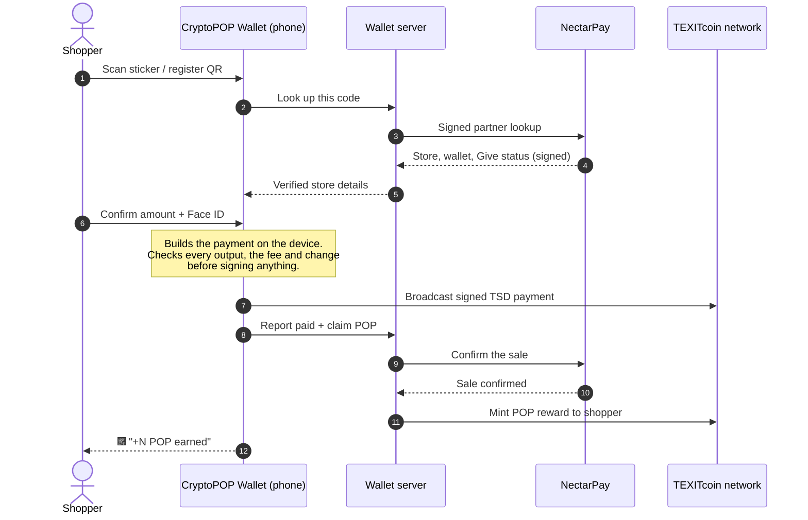

<div align="center">

# CryptoPOP Wallet

### Connect. Experience. Learn.

**A non-custodial wallet for paying local NectarPay merchants in Texas Stable Dollars, earning POP rewards, and giving to good causes as you go.**

[Open the wallet](https://app.cryptopop.org) · [Help center](https://app.cryptopop.org/help) · [Manifesto](https://app.cryptopop.org/manifesto) · Part of the [honest.money](https://honest.money) ecosystem


</div>

---

## What it is

CryptoPOP Wallet is a phone-first wallet that lives on the web. You add it to your home screen from Chrome on Android or Safari on iPhone. There's no app store and no download.

It does three things well:

| | |
|---|---|
| **Pay at the register** | Scan a NectarPay store sticker or register QR. The wallet looks up the store and its wallet address, you type or confirm the amount, and you pay in **TSD** (Texas Stable Dollar). |
| **Earn POP** | Every confirmed purchase at a NectarPay merchant earns **1 POP per $1**, rounded up, with fireworks when it lands. POP is a reward and not a currency to trade. |
| **Give while you shop** | If the store is in the Give program and you've picked a cause, one payment splits on the spot: **90% to the store, 8% to your cause, 2% to the Give program**. NectarPay still records the sale as paid in full. |

On top of that: tap-to-pay NFC cards, Face ID or fingerprint unlock, a merchant map, an in-app Help center, and a top-up path from the TSD bridge.

> **Your keys, your money.** The 12-word recovery phrase is created on your device and encrypted with your password. It never reaches our servers. Reloading the page locks the wallet.

---

## The assets

| Token | What it's for |
|---|---|
| **TSD** (Texas Stable Dollar) | What you spend. A dollar-pegged token on the TEXITcoin Omni layer. |
| **POP** | Proof-of-Participation rewards, earned by buying from merchants and joining in. Not spendable. |
| **TXC** (TEXITcoin) | The base coin. It pays the small network fees. |

TEXITcoin uses coin type `696969'` (SLIP-44). Learn more at [texitcoin.org/build](https://texitcoin.org/build).

---

## How a store payment works



Give payments go out as **one** Omni Send-To-Many transaction, so the three shares arrive together and nobody in between can change them. Cause wallets come fresh from NectarPay's **signed** list before every Give payment. Church addresses are never typed into the code or saved.

---

## Security model

This is a live wallet that handles real money, and every change goes through an independent security audit before it's published.

- **Non-custodial.** Keys are generated and encrypted on the device. Unlocked keys stay in memory only. Retired custodial code is kept read-only until old balances are reconciled.
- **Sign only what you meant.** Before signing, every transaction is checked against addresses the device owns, the outputs you intended, and local fee limits. Only TXC and TSD can be sent.
- **A fresh check for every payment.** Outgoing payments and spend-enabling card or Give changes need Face ID, fingerprint or your password, asked for right when you tap.
- **Face ID done right.** A WebAuthn passkey (PRF) wraps a second encrypted copy of the vault. We never store a password, and your biometric data never leaves your phone. If the passkey copy is missing or out of date, the wallet falls back to your password.
- **One custody exception, kept narrow.** NFC tap-to-pay cards use separate per-card "pocket" keys on their own derivation branch, encrypted at rest. Main-wallet keys are never exposed. Partner card calls are HMAC-signed.
- **Signed everything.** NectarPay lookups, cause lists, POP claims and ecosystem wallet links are all signature-checked. Unknown sites fail closed.
- **Locked-down browser policy.** A strict Content-Security-Policy, no third-party tracking scripts on the wallet, and the app can only be framed by itself and the Lovable editor.
- **No double-spending rewards.** Reward redemptions and QR use run inside database transactions, and door-scanner limits need admin approval.

Architecture rules and the reasons behind them live in [`AGENTS.md`](./AGENTS.md).

---

## Tech stack

| Layer | Choice |
|---|---|
| Framework | [TanStack Start](https://tanstack.com/start) v1 (React 19, SSR, server functions) on Vite 7 |
| Runtime | Cloudflare Workers (edge) |
| Styling | Tailwind CSS v4 with design tokens in `src/styles.css`, plus shadcn/ui |
| Backend | Lovable Cloud (Postgres with row-level security, auth, storage, scheduled jobs) |
| Crypto | `@noble/curves`, `@noble/hashes`, `@scure/bip32`/`bip39`, `bitcoinjs-lib`, plus Omni layer encoding |
| Install | Progressive Web App: manifest, service worker, offline page, home-screen install guidance |
| Tests | Vitest, with 181 tests across 24 files |

---

## Project layout

```text
src/
├── routes/                 Pages and API endpoints (file-based routing)
│   ├── index.tsx           Wallet home
│   ├── my-pop.tsx          POP balance, history, ways to earn
│   ├── give.tsx            Pick a cause to support
│   ├── nfc*.tsx            Tap-to-pay cards
│   ├── merchants.tsx       Merchant map
│   ├── help.tsx            Help center (shoppers, support, store owners)
│   ├── settings.tsx        Security, backup, Face ID, legal
│   └── api/public/         Partner webhooks: card pay, POP retry, Telegram, release feed
├── lib/
│   ├── wallet/             On-device engine: vault, signing, scan parsing,
│   │                       transaction policy, passkeys, payment approval
│   ├── give/               Give split rule and signed cause list
│   ├── nectarpay*.ts       Signed NectarPay proxy (stickers, QR lookup, claims)
│   ├── pop-claim.server.ts POP reward claims and minting
│   ├── nfc-card.server.ts  Card pocket keys and tap-to-pay
│   └── tsd-partner*.ts     TSD bridge top-ups
├── components/             UI, including wallet sheets and dialogs
└── styles.css              Brand tokens (colors, fonts, effects)
supabase/migrations/        Database schema history (72 migrations)
docs/                       Partner and audit handoff notes
```

---

## Running it locally

You'll need [Bun](https://bun.sh) (npm works too).

```sh
git clone <this-repository-url>
cd <repository-folder>
bun install
bun run dev          # http://localhost:8080
```

| Command | What it does |
|---|---|
| `bun run dev` | Start the dev server |
| `bun run build` | Production build for Cloudflare Workers |
| `bun run test` | Run the full wallet safety test suite |
| `bun run lint` | Lint the code |

### Configuration

The browser only gets publishable values, which come from `.env`. Private keys are stored as server secrets in Lovable Cloud and are **never** committed. The main ones, by name:

| Area | Secrets |
|---|---|
| TEXITcoin node and POP minting | `TXC_RPC_URL`, `TXC_RPC_USER`, `TXC_RPC_PASS`, `TXC_WIF`, `TXC_TOKEN_ID`, `TXC_TSD_TOKEN_ID` |
| NectarPay | `NECTARPAY_PARTNER_KEY` (with `NFC_PAY_SECRET` kept as a legacy fallback), `NECTARPAY_REWARDS_SECRET` |
| NFC cards | `CARD_KEY_ENC` |
| TSD bridge | `TSD_PARTNER_SECRET` |
| Honest Money ecosystem | `HME_ECOSYSTEM`, `ECOSYSTEM_SITES_URL` |
| Maps, alerts, email | `GOOGLE_MAPS_SERVER_KEY`, `TELEGRAM_API_KEY`, `AWS_SES_*` |

---

## Tests and CI

```sh
bun run test
```

The suite covers what matters most: transaction signing policy, split-payment checks, scan parsing, passkey and Face ID crypto, payment approval, POP claim signing, NFC card auth, rate limits and the TSD bridge protocol. The `Wallet safety tests` workflow runs it on every push and pull request.

---

## Deploying

Changes made in [Lovable](https://lovable.dev/projects/b8b9779f-344d-4518-a3e5-793851a03a68) are committed to this repo automatically, and pushes to `main` sync back into Lovable. Publishing goes out from Lovable to:

- **https://app.cryptopop.org**
- **https://wallet.cryptopop.org**
- https://cryptopop-wallet.lovable.app

Every release gets a third-party security review before it goes live.

---

## Ecosystem

CryptoPOP is part of the **[Honest Money Ecosystem](https://honest.money)** (HME), the umbrella for the TXC, ISK and ZCU networks and the tools built on them.

- TEXITcoin and Omni layer 2: [texitcoin.org/build](https://texitcoin.org/build)
- ZCU: [zerochill.com/build](https://zerochill.com/build)
- Ecosystem integration: [honest.money/api](https://honest.money/api)
- Payments partner: [NectarPay](https://app.nectar-pay.com)

---

<div align="center">

Part of the [honest.money](https://honest.money) ecosystem ·
[Terms](https://app.cryptopop.org/terms) ·
[Privacy](https://app.cryptopop.org/privacy) ·
[Manifesto](https://app.cryptopop.org/manifesto)

<sub>Built with care for real communities. Never financial advice. POP is a reward and not an investment.</sub>

</div>
